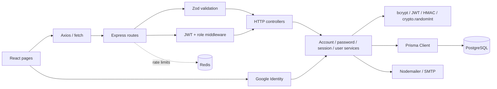

# Luồng tài khoản và thông tin người dùng

Tài liệu này mô tả mã nguồn hiện tại cho đăng ký, đăng nhập, OTP/quên mật khẩu, hồ sơ cá nhân và quản lý user bởi ADMIN. Các đường dẫn trong tài liệu tính từ thư mục gốc dự án.

## Tổng quan kiến trúc



Luồng thường đi qua: **trang giao diện → API client → Express route → middleware kiểm tra/chuẩn hóa → controller → service → công cụ xác thực hoặc Prisma/PostgreSQL**. Controller nhận request và định dạng response; quy tắc nghiệp vụ nằm trong service.

## Công cụ thực hiện chức năng

| Công cụ | Vai trò |
| --- | --- |
| React, React Router, TypeScript | Form và điều hướng đăng ký/đăng nhập/OTP/hồ sơ/admin. |
| Axios và `fetch` | Gửi request JSON kèm cookie qua `withCredentials`/`apiFetch`; JWT không được đọc hoặc lưu trong JavaScript. |
| Express Router | Định tuyến API dưới `/api/auth` và `/api/admin`. |
| Zod | Chuẩn hóa/kiểm tra name, email, password, OTP, role và ID trước controller. Email trim và chuyển chữ thường. |
| Middleware xác thực/phân quyền | Xác minh JWT, kiểm tra session trong PostgreSQL, nạp role hiện tại rồi giới hạn quyền ADMIN. |
| Redis rate limit | Bộ đếm chống thử nhiều lần đăng nhập/gửi OTP/xác minh OTP; có `Retry-After`. |
| Prisma + PostgreSQL | Lưu User/AuthSession, hash password, HMAC OTP, role, thời điểm/phiên bản điều khoản, cờ xóa mềm và phiên. |
| `bcryptjs` | Hash/so sánh mật khẩu; cost 10 rounds. |
| `jsonwebtoken`, `node:crypto` | JWT HS256; UUID session, `randomInt` sinh OTP, HMAC-SHA256 bảo vệ OTP lưu DB. |
| Nodemailer + SMTP | Gửi mã khôi phục password qua email. Cần cấu hình SMTP. |
| `google-auth-library` | Xác minh Google ID token và audience bằng `GOOGLE_CLIENT_ID`. |

Docker/AWS SQS không tham gia trực tiếp vào các luồng tài khoản. Database, Redis, SMTP và cấu hình Google mới liên quan ở đây.

## Đăng ký

1. `frontend/src/pages/Register.tsx` nhận tên, email, password, xác nhận password và checkbox điều khoản.
2. Giao diện kiểm tra password trùng nhau và checkbox được chọn, sau đó gọi `POST /api/auth/register` với `{name,email,password,acceptedTerms:true}`.
3. `backend/src/routes/index.ts` mount `auth.routes.ts` tại `/api/auth`. Route đăng ký áp rate limit **10 request/IP/15 phút**, rồi `validateBody(registerBody)` của Zod.
4. Controller `register` gọi `registerService` (`backend/src/services/auth/account.service.ts`). Nếu thiếu chấp thuận, backend từ chối kể cả khi client tự bỏ qua UI.
5. Service chuẩn hóa email, kiểm tra email tồn tại. Nếu đã tồn tại, trả `EMAIL_ALREADY_EXISTS`.
6. `hashPassword` dùng bcrypt để hash password. Service tạo user với role mặc định `STUDENT`, lưu `termsAcceptedAt` và `termsVersion` từ cấu hình backend `TERMS_VERSION`.
7. Backend trả HTTP 201 với user công khai, **không tạo phiên và không trả JWT**. Giao diện báo thành công rồi chuyển đến `/login`.

Đường dẫn code: `Register.tsx` → `routes/auth.routes.ts` → `validation/request.schemas.ts` → `controllers/common/auth.controller.ts` → `services/auth/account.service.ts` → `utils/auth.ts` → Prisma/PostgreSQL.

## Đăng nhập

### Email/password

`frontend/src/pages/Login.tsx` gửi email/password tới `POST /api/auth/login`. Route áp giới hạn **20 lần/IP/15 phút** và **10 lần/email/15 phút**, sau đó xác thực body bằng Zod.

`loginService` tìm email chuẩn hóa trong PostgreSQL. User không tồn tại hoặc xóa mềm nhận thông báo chung thông tin đăng nhập sai. Tài khoản không có password local nhận thông báo dùng Google. Nếu có password, `bcryptjs.compare` so sánh với hash. Khi hợp lệ, backend gọi `issueSession`, lưu session và ký JWT; trường nhạy cảm bị bỏ khỏi user trong response.

Backend đặt JWT trong cookie `judge_session` có `HttpOnly`, `SameSite=Lax`, `Path=/api`; production bật thêm `Secure`. Response chỉ trả user công khai. User STUDENT đi vào trang chính; ADMIN được hỏi chọn trang quản trị. Khi khởi động phiên bản mới, frontend xóa token/role cũ từng lưu ở `localStorage`.

### Google

Khi Google Sign-In được cấu hình, giao diện yêu cầu người dùng chọn checkbox điều khoản rồi nút `GoogleLogin` lấy credential và gửi `POST /api/auth/google` cùng `acceptedTerms:true`. Schema backend bắt buộc giá trị này. `googleLoginService` xác minh ID token với Google, audience `GOOGLE_CLIENT_ID`, email và `email_verified=true`. User mới được tạo role `STUDENT`, `pwd` rỗng, kèm `termsAcceptedAt`/`termsVersion`; tài khoản Google cũ chưa có dấu chấp thuận sẽ được ghi nhận ở lần đăng nhập xác nhận đầu. Sau đó hệ thống tạo AuthSession/JWT giống đăng nhập thường. Google không tự cấp role ADMIN.

### Middleware cho các request có xác thực

`authenticate` trong `backend/src/middlewares/auth.middleware.ts` đọc cookie `judge_session`, xác minh JWT HS256/hạn dùng và kiểm tra claim. Sau đó `readSession` truy vấn `AuthSession` cùng User trong DB, từ chối phiên hết hạn/thu hồi, user đã xóa hoặc `tokenVersion` không còn khớp. Middleware đặt role đọc từ DB vào `req.user`; các route admin áp thêm `authorize('ADMIN')`. Bearer token không còn được nhận.

Client Axios bật `withCredentials`; `apiFetch` luôn gửi cookie. CORS backend bật credentials và chỉ cho origin trong `CORS_ORIGINS` truy cập response.

## Quên mật khẩu và OTP

### Gửi mã

1. `frontend/src/pages/ForgotPassword.tsx` gửi email tới `POST /api/auth/forgot-password`.
2. Route giới hạn **10 lần/IP** và **3 lần/email trong 15 phút**, rồi Zod kiểm tra/chuẩn hóa email.
3. `forgotPasswordService` tìm user hoạt động. Email không tồn tại, bị xóa, SMTP chưa cấu hình hoặc gửi mail thất bại đều nhận cùng phản hồi tiếp nhận chung để không làm lộ tình trạng tài khoản.
4. Chỉ khi user đang hoạt động và SMTP có cấu hình, `node:crypto.randomInt` sinh mã 6 chữ số, thêm số 0 đầu nếu cần; hạn dùng 15 phút.
5. DB lưu digest `HMAC-SHA256(JWT_SECRET, "reset-password\\0" + email chuẩn hóa + "\\0" + mã)`, không lưu mã rõ. `sendResetPasswordEmail` của Nodemailer gửi OTP qua SMTP.
6. Nếu gửi mail thất bại, service cố xóa digest/thời hạn vừa ghi, ghi log chung không chứa địa chỉ/mã OTP rồi vẫn trả phản hồi chung.
7. Khi request thành công, UI cho chuyển tới `/reset-password`, truyền email qua React Router location state.

### Xác minh OTP và đặt mật khẩu

`frontend/src/pages/ResetPassword.tsx` nhận email, OTP, password mới và xác nhận; kiểm tra mã 6 số và password trùng nhau. Request:

```http
POST /api/auth/reset-password
{ "email": "...", "otp": "123456", "newPassword": "..." }
```

Route giới hạn **5 lần/email/15 phút** và còn rate limit IP, rồi Zod kiểm tra body. `resetPasswordService` tính HMAC mới, tìm user có email/digest khớp, chưa xóa và OTP chưa hết hạn. Service hash password mới bằng bcrypt rồi dùng một lệnh `updateMany` có điều kiện digest và expiration để tiêu thụ mã một lần, kể cả khi có request đồng thời. Lệnh này cập nhật `pwd`, xóa HMAC/expiration và tăng `tokenVersion`.

Tăng version làm token/session cũ không hợp lệ ở lần xác thực kế tiếp. Backend trả thành công, frontend chuyển về `/login`.

OTP gắn với email qua HMAC; giới hạn verify hiện tại là 5 lần/email/15 phút. Mã hết hạn sau 15 phút.

## Hồ sơ cá nhân, đổi mật khẩu và đăng xuất

### Hồ sơ

`frontend/src/pages/Profile.tsx` gọi `GET /api/auth/me` bằng cookie phiên. Nếu phiên không hợp lệ, chuyển về `/login`. `getMeService` chỉ trả `id/name/email/role/createdAt`.

Form cập nhật chỉ sửa tên: `PUT /api/auth/me` với `{name}`. Email hiển thị chỉ đọc ở UI. `profileBody` kiểm tra tên; `updateProfileService` trim và ghi tên mới, rồi trả bộ trường công khai.

### Đổi mật khẩu

Modal hồ sơ nhận mật khẩu hiện tại, password mới, xác nhận. Client kiểm tra password xác nhận và tối thiểu 6 ký tự; gọi `PUT /api/auth/change-password` bằng cookie phiên. Backend kiểm tra session, validate body (`currentPassword` hoặc alias `oldPassword`) rồi `changePasswordService` nạp user, so sánh mật khẩu cũ với bcrypt, băm mật khẩu mới và tăng `tokenVersion`. Controller xóa cookie hiện tại; các phiên khác bị vô hiệu ở lần dùng kế tiếp.

### Logout

- `POST /api/auth/logout`: công khai để có thể xóa cả cookie hết hạn; nếu cookie còn JWT hợp lệ, server đánh dấu `revokedAt` cho đúng session rồi xóa cookie.
- `POST /api/auth/logout-all`: tăng `tokenVersion`, làm mất hiệu lực mọi phiên và xóa cookie hiện tại.
- `frontend/src/services/session.ts` gọi server để thu hồi phiên; trình duyệt không lưu JWT trong Web Storage.

`AuthSession` lưu session ID/jti, user ID, token version, expiresAt, revokedAt và createdAt. Maintenance định kỳ dọn session hết hạn.

## ADMIN quản lý sinh viên

`backend/src/routes/admin.routes.ts` đặt `authenticate` và `authorize('ADMIN')` trước mọi route `/api/admin`. Các endpoint trong `backend/src/routes/admin/user.routes.ts`:

| Method | Endpoint | Hành động |
| --- | --- | --- |
| GET | `/api/admin/users` | Liệt kê STUDENT chưa soft-delete và số submission. |
| POST | `/api/admin/users` | Tạo user, role mặc định STUDENT; password riêng là bắt buộc. |
| PUT | `/api/admin/users/:id` | Cập nhật trường được gửi: tên/email/password/role. |
| DELETE | `/api/admin/users/:id` | Xóa mềm, đồng thời thu hồi hiệu lực token. |

`frontend/src/pages/AdminUsers.tsx` gọi API bằng cookie phiên, lọc tên/email và phân trang phía client. Mật khẩu chỉ gửi khi tạo mới hoặc khi admin nhập password mới lúc sửa. Xóa có hộp xác nhận và giữ lại lịch sử.

Controller `controllers/admin/user.controller.ts` chuyển tiếp đến `services/user.admin.service.ts`:

- **Danh sách:** chỉ lấy STUDENT với `deletedAt=null`, sắp xếp mới trước; chỉ chọn trường công khai và số submission.
- **Tạo:** kiểm tra email trùng, yêu cầu password riêng, bcrypt hash rồi insert.
- **Sửa:** kiểm tra user hoạt động/email không trùng; chỉ ghi trường gửi lên. Đổi password sẽ hash và tăng `tokenVersion`. Role mới đọc từ DB ở request kế tiếp.
- **Xóa:** đặt `deletedAt`, tăng `tokenVersion`, xóa OTP và thay email bằng địa chỉ vô hiệu `deleted+<userId>@deleted.invalid`. Submission/history vẫn tham chiếu cùng user ID; email gốc có thể đăng ký tài khoản mới.

Trang hiện quản lý danh sách sinh viên, không phải công cụ quản lý mọi tài khoản ADMIN. Email database vẫn unique; khi xóa mềm, service đổi email sang địa chỉ `.invalid`, nên email gốc có thể dùng đăng ký tài khoản mới.

## Dữ liệu user trong PostgreSQL

Model `User` trong `backend/prisma/schema.prisma` ánh xạ bảng `users`.

| Trường | Nội dung |
| --- | --- |
| `id` | UUID. |
| `name`, `email` | Thông tin người dùng; email unique. |
| `pwd` | bcrypt hash hoặc rỗng với OAuth chưa có password local. |
| `role` | STUDENT/ADMIN; mặc định STUDENT. |
| `resetPasswordToken`, `resetPasswordExpires` | HMAC OTP và thời hạn; mã rõ chỉ được gửi email. |
| `createdAt`, `deletedAt` | Ngày tạo và dấu xóa mềm. |
| `termsAcceptedAt`, `termsVersion` | Thời điểm đồng ý và phiên bản điều khoản được cấu hình qua `TERMS_VERSION`; dữ liệu cũ chưa có giá trị. |
| `tokenVersion` | Thu hồi phiên/token cũ. |

`AuthSession` ánh xạ bảng `auth_sessions`. OTP email không có bảng riêng. JWT chỉ nằm trong cookie `HttpOnly`; password/OTP nằm trong state form để gửi request. `localStorage` chỉ còn dùng cho tùy chọn giao diện như ngôn ngữ/chủ đề.

## Rate limit và lỗi

| Endpoint | Giới hạn |
| --- | --- |
| Đăng ký | 10/IP/15 phút |
| Login thường | 20/IP và 10/email/15 phút |
| Google login | 20/IP/15 phút |
| Gửi OTP | 10/IP và 3/email/15 phút |
| Xác minh OTP | 5/email/15 phút và limit IP |

Các limiter được khai báo trong `routes/auth.routes.ts`, dùng middleware Redis. `validateBody` trả `VALIDATION_ERROR` trước controller. Nghiệp vụ dùng `AppError`, ví dụ `TERMS_REQUIRED`, `EMAIL_ALREADY_EXISTS`, `INVALID_CREDENTIALS`, `INVALID_RESET_CODE`, `UNAUTHENTICATED`, `SESSION_REVOKED`, `FORBIDDEN`; lỗi gửi OTP được ghi log chung phía server và API vẫn trả phản hồi chung.

## Danh sách file để lần theo source

1. UI: `frontend/src/pages/Register.tsx`, `Login.tsx`, `ForgotPassword.tsx`, `ResetPassword.tsx`, `Profile.tsx`, `AdminUsers.tsx`.
2. API client: `frontend/src/services/api.ts`, `frontend/src/services/session.ts`.
3. Router/validation/auth: `backend/src/routes/auth.routes.ts`, `admin.routes.ts`, `admin/user.routes.ts`, `backend/src/validation/request.schemas.ts`, `middlewares/validation.middleware.ts`, `middlewares/auth.middleware.ts`, `middlewares/rate-limit.middleware.ts`.
4. HTTP handlers: `backend/src/controllers/common/auth.controller.ts`, `common/session.controller.ts`, `admin/user.controller.ts`.
5. Nghiệp vụ: `backend/src/services/auth/account.service.ts`, `password.service.ts`, `google.service.ts`, `profile.service.ts`, `session.service.ts`, `backend/src/services/user.admin.service.ts`.
6. Công cụ và dữ liệu: `backend/src/utils/auth.ts`, `utils/emailService.ts`, `backend/src/config/env.ts`, `config/db.ts`, `config/redis.ts`, `backend/prisma/schema.prisma`.

## Cấu hình cần có khi bật tích hợp

- `TERMS_VERSION` là mã phiên bản điều khoản backend lưu khi đăng ký; tăng giá trị này khi phát hành phiên bản điều khoản mới. Dữ liệu đăng ký trước migration sẽ có hai trường điều khoản rỗng.
- Google Sign-In chỉ hiện khi frontend có `VITE_GOOGLE_CLIENT_ID`; backend cần cùng giá trị ở `GOOGLE_CLIENT_ID` để kiểm tra audience.
- Muốn gửi OTP thực tế cần `SMTP_HOST`, `SMTP_PORT`, `SMTP_USER`, `SMTP_PASS`. Thiếu SMTP không làm lộ tài khoản và API vẫn phản hồi chung, nhưng hệ thống không thể gửi thư.
- Cấu hình bí mật đặt trong `.env` (đã được Git ignore); chỉ commit file `.env.example`, không commit thông tin SMTP, JWT hoặc OAuth bí mật.
