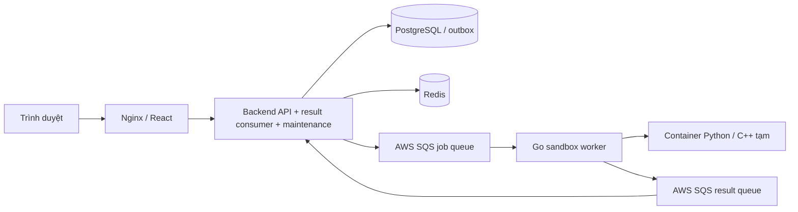

# Chạy Judge System bằng Docker và AWS SQS

## Khởi động và triển khai

Hệ thống chính có **5 container thường trực**. Cần Docker Engine/Docker Desktop, Docker Compose v2 và cấu hình AWS SQS hợp lệ. Node.js 24 dùng cho các script cấu hình trên host.

Máy mới tạo `.env` một lần:

```sh
node docker/setup-env.mjs
```

Nếu `backend/.env` đã có AWS credentials và hai queue URL thật, chuyển cấu hình đó sang `.env` root:

```sh
node docker/configure-aws.mjs --from-backend
```

Script chỉ cập nhật các trường AWS/SQS, giữ database/JWT/SMTP/Google, đặt quyền file 600 và không in secrets. Không cần chạy lại nếu `.env` root đã đúng. Có thể tự điền cấu hình theo `.env.example`; dùng `node docker/configure-aws.mjs` để kiểm tra URL/region/credentials mà không sửa file hay gọi AWS.

**Triển khai lần đầu hoặc khi thay đổi migration/queue:**

```sh
sh docker/deploy.sh
```

Script kiểm tra cấu hình AWS, build image, khởi động PostgreSQL/Redis, chuẩn bị queue/DLQ, dừng ứng dụng để cập nhật, backup PostgreSQL vào `.local/backups/`, áp migration rồi khởi động hệ thống và chờ healthcheck. Provision queue lỗi thì dừng trước khi dừng ứng dụng đang chạy. Backup/migration lỗi thì dừng triển khai; không reset database. `docker/start.sh` là alias của lệnh deploy.

**Các lần khởi động bình thường:**

```sh
docker compose up -d
```

Backend kiểm tra trạng thái migration và queue trước khi mở API; không tự áp migration hoặc tạo queue. Khi có migration chưa áp, chạy lại deploy. Go worker tự build image Python/C++ khi thiếu hoặc checksum Dockerfile thay đổi. Frontend chờ backend và sandbox healthy; lần tải image đầu có thể mất vài phút.

| Địa chỉ mặc định | Mục đích |
| --- | --- |
| http://localhost:8080 | Frontend React qua Nginx |
| http://localhost:8080/api/categories | API cùng origin qua Nginx |
| http://localhost:5001/health | Health PostgreSQL/Redis |
| localhost:5433 | PostgreSQL cho công cụ quản trị trên host |

Backend/PostgreSQL chỉ publish lên 127.0.0.1; Redis và Go worker không publish cổng. Đổi FRONTEND_PORT/BACKEND_PORT/POSTGRES_PORT trong `.env` nếu cần.

## Các container và luồng xử lý

| Service | Trách nhiệm |
| --- | --- |
| frontend | Nginx phục vụ React, proxy /api sang backend. |
| backend | HTTP API, result consumer, heartbeat, dispatch outbox/retry, reconciliation và session cleanup trong một tiến trình Node.js. |
| sandbox-worker | Go worker nhận job từ AWS, tạo sandbox Python/C++, gửi kết quả/heartbeat về AWS. |
| postgres | Dữ liệu chính: tài khoản, session, bài tập, testcase, submission, kết quả và outbox. |
| redis | Run tạm theo TTL, rate limit và worker heartbeat. |

RESULT_WORKER_ENABLED=true được cố định trong Compose. Không chạy thêm consumer riêng với cùng cấu hình. Khi API khởi động/dừng/cập nhật, consumer và maintenance cùng vòng đời; SIGTERM hủy long polling và đóng kết nối sau khi xử lý dừng. Backend có stop_grace_period=20s.



Không có container migrate, sqs-ready, result-worker hoặc ElasticMQ trong Compose chính. Các lệnh triển khai dùng `docker compose run --rm`: container lệnh tự xóa sau khi hoàn tất, không lưu trong danh sách service thường trực. Image Python/C++ được Go worker chuẩn bị và dùng để tạo sandbox riêng cho từng job, xóa sau khi chấm. Image có label judge.dockerfile.sha256 để tránh build lại khi Dockerfile không đổi.

Compose dùng pull_policy=build cho backend/frontend/Go worker để một lệnh up dùng source hiện tại và tận dụng build cache.

## Migration và queue bằng lệnh riêng

Nếu không dùng script deploy, thực hiện các bước tương đương (dừng backend/sandbox/frontend trước khi áp schema mới):

```sh
docker compose build
docker compose up -d --wait postgres redis
docker compose run --rm --no-deps -e SQS_AUTO_CREATE=true backend node dist/src/workers/queue.ready.entry.js
docker compose stop frontend sandbox-worker backend
sh docker/backup.sh
docker compose run --rm --no-deps backend npm run db:deploy
docker compose up -d --remove-orphans --wait --wait-timeout 600
```

Prisma migrate deploy áp migration đã có, không seed hoặc reset dữ liệu. API startup dùng migrate status chỉ để kiểm tra. Xem [Prisma Migrate v7](https://www.prisma.io/docs/orm/v7/prisma-migrate/workflows/development-and-production).

Runtime luôn dùng SQS_AUTO_CREATE=false. Chỉ lệnh triển khai đặt true để tạo standard queues/DLQ và cấu hình VisibilityTimeout=120 giây, MessageRetentionPeriod=4 ngày, maxReceiveCount=3; DLQ giữ message 14 ngày. Queue name tối đa 75 ký tự để thêm hậu tố -dlq. Script queue retry tối đa 30 lần nếu AWS chưa sẵn sàng hoặc quyền chưa phù hợp.

## Cấu hình AWS SQS

Trong `.env` root:

```dotenv
AWS_REGION=ap-southeast-1
AWS_ACCESS_KEY_ID=YOUR_ACCESS_KEY
AWS_SECRET_ACCESS_KEY=YOUR_SECRET_KEY
AWS_SESSION_TOKEN=
SQS_ENDPOINT_URL=
SQS_QUEUE_URL=https://sqs.ap-southeast-1.amazonaws.com/YOUR_ACCOUNT_ID/YOUR_JOB_QUEUE
RESULT_QUEUE_URL=https://sqs.ap-southeast-1.amazonaws.com/YOUR_ACCOUNT_ID/YOUR_RESULT_QUEUE
SQS_AUTO_CREATE=false
```

Dùng queue standard, cùng region/account và hai URL khác nhau. Compose chính để SQS_ENDPOINT_URL rỗng, không có endpoint local. Không dùng credentials giả local. Trên môi trường hỗ trợ IAM role có thể để trống access key/secret để SDK dùng credential chain; Docker Desktop không tự nhận credentials trên host nếu chúng chưa được cấp vào container. Xem [AWS SDK Node credential chain](https://docs.aws.amazon.com/sdk-for-javascript/v3/developer-guide/setting-credentials-node.html).

Quyền runtime trên hai queue: sqs:SendMessage, sqs:ReceiveMessage, sqs:DeleteMessage, sqs:GetQueueAttributes. Dashboard đọc GetQueueAttributes trên DLQ. Provision cần thêm sqs:CreateQueue và sqs:SetQueueAttributes cho queue/DLQ tương ứng. Không cần quyền DeleteQueue/PurgeQueue cho triển khai này. Nếu dùng KMS key riêng, bổ sung quyền KMS theo cấu hình AWS. Tham khảo [AWS SQS permissions](https://docs.aws.amazon.com/AWSSimpleQueueService/latest/SQSDeveloperGuide/sqs-api-permissions-reference.html).

## Dữ liệu và sao lưu

PostgreSQL giữ volume **judge-system-monorepo_postgres_data**, container judge_postgres, mount /var/lib/postgresql/data. Redis giữ volume của dự án. Đổi POSTGRES_VOLUME_NAME sẽ chọn database khác; volume mới bắt đầu rỗng. Password/user/database trong `.env` phải khớp volume đã tồn tại; thay biến POSTGRES_PASSWORD không tự đổi password trong database.

Repository hiện có 7 migration; `playground_run_history` tạo bảng lưu lịch sử chạy PLAYGROUND, còn PROBLEM_TRIAL vẫn dùng Redis TTL. Các migration reliability trước đó thêm session/outbox/version/soft delete/metrics/FK RESTRICT. Dữ liệu lịch sử được giữ; memoryUsed=0 cũ chuyển null vì chưa đo. JWT/OTP trước migration reliability cần đăng nhập/yêu cầu mã mới. Sau khi đã nâng cấp, khởi động lại không tự thu hồi session.

Backup thủ công:

```sh
sh docker/backup.sh
```

Restore vào **database mới/rỗng**:

```sh
docker compose exec -T postgres sh -c 'pg_restore -U "$POSTGRES_USER" -d "$POSTGRES_DB" --no-owner --exit-on-error' < .local/backups/TEN_FILE.dump
```

`.local/` và `.env` được Git ignore, chứa dữ liệu riêng. `docker compose down` giữ volume; `down -v` xóa volume/dữ liệu. Deploy dùng --remove-orphans để dọn container cấu hình cũ, không xóa volume cũ của ElasticMQ và không tự chuyển message local sang AWS. Kiểm tra/hoàn tất công việc local trước khi chuyển queue.

## Theo dõi và kiểm thử

```sh
docker compose ps -a
docker compose logs --tail=100 backend sandbox-worker
```

Health API xác nhận PostgreSQL/Redis; startup xác nhận migration/queue. Heartbeat trên dashboard phản ánh Go worker qua AWS SQS. AI/Google/SMTP cần cấu hình provider thật riêng; không coi health API là kiểm chứng các provider này.

Kiểm thử tích hợp độc lập:

```sh
sh docker/test.sh
```

Stack judge-packaging-smoke dùng volume tạm riêng, không publish cổng và không dùng queue AWS thật. ElasticMQ chỉ được khai báo trong docker/compose.test.yml; docker/elasticmq.conf và Dockerfile.sqs phục vụ kiểm thử này. Script pin endpoint và credentials local, chạy migration/queue bằng lệnh triển khai riêng, kiểm tra backend gộp consumer/maintenance. Trong ca outbox, backend test được recreate với consumer tạm tắt, sau đó bật lại; không thêm endpoint điều khiển worker vào ứng dụng.

Bộ kiểm thử kiểm tra Python/C++ output, TLE/MLE/CE, peak memory/CPU, outbox retry/rollback/deadline, session/role/logout, CORS, OTP, rate limit, version testcase/soft delete/FK, leaderboard, heartbeat/DLQ và pg_dump/pg_restore. Nó tự dọn riêng project/volume test khi kết thúc. Các fixture yêu cầu JUDGE_INTEGRATION_TEST=true; không chạy chúng trên stack database thật.

## Kết quả xác minh ngày 17/10/2026

- Stack chính có 5 container chạy, không còn ElasticMQ/result-worker riêng. Backend/frontend trả HTTP 200; backend chạy consumer/maintenance trong cùng tiến trình.
- AWS SQS region ap-southeast-1: đọc được job queue, result queue và cả hai DLQ; DLQ có 0 message tại thời điểm kiểm tra. Go worker gửi heartbeat IDLE qua AWS.
- Smoke chạy thử qua AWS thật: Python và C++ tính 7 + 13 đều RUN_SUCCESS, output 20. Python đo peak 5752 KiB, CPU 23 ms, wall 59 ms; C++ đo peak 7144 KiB, CPU 10 ms, wall 41 ms, compile 200 ms. Đây là số đo một lần chạy, không phải benchmark. Các run chỉ lưu Redis tạm và đã được dọn; không tạo submission/user trong PostgreSQL.
- Integration stack local độc lập: 17 nhóm kiểm tra PASS; backend unit/HTTP: 26 pass, 2 integration opt-in skip. Chưa dùng các fixture tạo dữ liệu này trên queue AWS thật; phạm vi cloud đã kiểm tra là chạy thử Python/C++, heartbeat và queue/DLQ.
- Database trước/sau giữ nguyên 1 user, 17 problems, 28 submissions và 33 submission_results; đủ 5 migration, không có bài chính thức đang chờ trước chuyển đổi. Backup trước triển khai: `.local/backups/judge-db-20261017-180146-64714.dump`.
- Cấu hình `.env` root đã chuyển sang AWS từ backend/.env. Bản cấu hình trước chuyển đổi được lưu riêng trong `.local/deployment/`; không đưa các file này lên Git.
