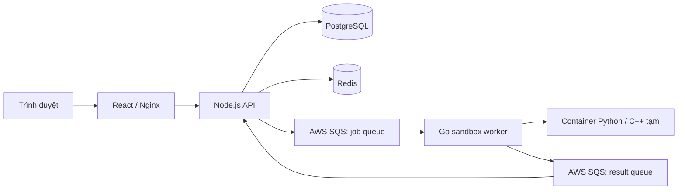

# Judge System

Judge System là nền tảng thực hành lập trình trực tuyến. Người học có thể tìm bài tập, viết và chạy Python/C++, thử với testcase công khai, nộp lời giải để chấm bằng testcase công khai và ẩn, xem lịch sử kết quả và theo dõi tiến độ. Quản trị viên quản lý người dùng, bài tập, testcase và theo dõi hoạt động xử lý.

Hệ thống gồm React + Vite ở frontend, Node.js/TypeScript + Express ở backend, Go worker nhận tác vụ chấm, PostgreSQL lưu dữ liệu chính, Redis lưu trạng thái tạm và giới hạn tốc độ, cùng AWS SQS để phân phối job và trả kết quả. Mỗi lần chạy mã nguồn được thực hiện trong container sandbox Python hoặc C++ riêng với giới hạn tài nguyên.

## Kiến trúc và luồng chấm



Docker Compose khởi chạy 5 service thường trực: `frontend`, `backend`, `sandbox-worker`, `postgres` và `redis`. API chạy result consumer và maintenance trong cùng tiến trình. Container Python/C++ được tạo riêng theo tác vụ rồi xóa sau khi thực thi; chúng không phải service thường trực. Stack chính dùng AWS SQS thật, không chạy ElasticMQ.

## Yêu cầu để thành viên bắt đầu

- Git.
- Docker Engine và Docker Compose v2 (Docker Desktop trên macOS/Windows hoặc Docker Engine trên Linux). Docker daemon phải đang chạy; worker cần truy cập Docker socket để tạo sandbox.
- Node.js 24 trở lên trên máy host để chạy script cấu hình.
- Quyền sử dụng AWS SQS và cấu hình hai queue: job queue và result queue, cùng AWS Region/account. Tài khoản cần quyền runtime gửi/nhận/xóa message và đọc queue attributes; lần triển khai đầu cần thêm quyền tạo queue và đặt queue attributes.
- Các cổng `8080`, `5001` và `5433` phải còn trống theo mặc định.

Nếu chưa được cấp AWS SQS, hãy nhờ người quản lý môi trường cung cấp queue URLs và AWS credential/role qua kênh bảo mật. Không đưa credential vào Git hoặc gửi chúng trong issue/chat công khai. Mỗi môi trường phát triển độc lập cần cặp queue riêng; không để nhiều worker của các máy có database riêng cùng đọc một queue dùng chung, vì worker có thể nhận job của máy khác.

## Khởi chạy lần đầu

### 1. Lấy mã nguồn

```sh
git clone <GIT_REPOSITORY_URL>
cd judge-system-monorepo
```

Thay `<GIT_REPOSITORY_URL>` bằng URL repository của nhóm.

### 2. Tạo cấu hình local

Kiểm tra Docker và Node.js, sau đó tạo `.env`:

```sh
docker compose version
node --version
node docker/setup-env.mjs
```

Script tạo JWT secret và mật khẩu PostgreSQL ngẫu nhiên, đặt quyền đọc file hạn chế và không ghi đè `.env` đã có. Nếu thư mục có sẵn `backend/.env`, script sẽ dùng một số cấu hình hiện có để khởi tạo `.env` root.

Mở `.env` bằng trình soạn thảo và điền:

- `AWS_REGION`.
- `SQS_QUEUE_URL` và `RESULT_QUEUE_URL` — hai URL queue standard khác nhau, cùng region và AWS account. URL có dạng `https://sqs.<region>.amazonaws.com/<account-id>/<queue-name>`.
- Credential AWS nếu chạy Docker local bằng access key; có thể để trống khi môi trường container đã được cấu hình credential chain/IAM role.

Giữ `SQS_ENDPOINT_URL` rỗng khi dùng AWS thật. Các tích hợp Google, SMTP và AI là tùy chọn; chỉ điền nếu muốn sử dụng các chức năng đó. Không cần tự đặt `DATABASE_URL`: Compose tạo URL nội bộ từ cấu hình PostgreSQL trong `.env`.

Nếu nhóm đã cấp AWS config trong `backend/.env`, có thể chuyển riêng các trường AWS/SQS sang `.env` root bằng lệnh sau:

```sh
node docker/configure-aws.mjs --from-backend
```

Kiểm tra cấu hình AWS/SQS mà không sửa file:

```sh
node docker/configure-aws.mjs
```

`.env` và dữ liệu local đã được Git ignore. Không commit file này; chỉ commit các file `.env.example` chứa giá trị mẫu.

### 3. Build, chuẩn bị database/queue và khởi động

Chạy từ thư mục gốc repository:

```sh
sh docker/deploy.sh
```

Lệnh này build image, khởi động PostgreSQL/Redis, tạo hoặc kiểm tra queue và DLQ, backup database vào `.local/backups/`, chạy Prisma migrations rồi khởi động stack và chờ healthcheck. Lần đầu có thể mất vài phút do tải base image, cài dependencies và chuẩn bị image sandbox Python/C++.

Khi hoàn tất, mở:

- Frontend: <http://localhost:8080>
- API health: <http://localhost:5001/health>
- API categories qua frontend proxy: <http://localhost:8080/api/categories>

Đăng ký tài khoản người học từ giao diện. Không có tài khoản quản trị mặc định được seed; thành viên cần nhờ người quản lý hệ thống cấp quyền quản trị theo quy trình nội bộ. Gửi email OTP, đăng nhập Google và gợi ý AI chỉ hoạt động khi cấu hình SMTP, Google OAuth hoặc AI provider tương ứng.

### 4. Khởi động những lần tiếp theo

Sau khi cấu hình và migrate thành công, dùng:

```sh
docker compose up -d
```

Compose build lại image khi source thay đổi và khởi động các service cần thiết. Nếu có migration mới hoặc thay đổi cấu hình queue, chạy lại `sh docker/deploy.sh` thay vì chỉ khởi động lại API.

### 5. Kiểm tra trạng thái và log

```sh
docker compose ps -a
docker compose logs --tail=100 backend sandbox-worker
```

Trong giao diện, người dùng có thể chạy code với stdin, chạy thử testcase công khai, nộp bài chính thức và xem kết quả. Job nộp bài đi qua AWS SQS; kết quả được lưu trong PostgreSQL. Các lần chạy thử được lưu tạm theo TTL trong Redis.

## Dừng, khởi động lại và dữ liệu

Dừng container nhưng giữ database và volume:

```sh
docker compose down
```

Khởi động lại:

```sh
docker compose up -d
```

**Không chạy `docker compose down -v` nếu muốn giữ dữ liệu.** Tùy chọn `-v` xóa volume PostgreSQL và Redis. PostgreSQL dùng volume Docker; `.local/backups/` chứa bản sao lưu do script deploy/backup tạo ra.

Tạo backup thủ công:

```sh
sh docker/backup.sh
```

Hướng dẫn restore, chuyển queue, cấu hình AWS, cổng và kiểm thử tích hợp nằm trong [DOCKER.md](DOCKER.md). Stack kiểm thử độc lập chạy bằng `sh docker/test.sh`; stack này dùng database/queue tạm, không thay cho môi trường ứng dụng thông thường.

## Lưu ý khi phát triển theo nhóm

- Mỗi thành viên có `.env`, database volume và cấu hình AWS riêng. Chia sẻ mẫu `.env.example`, không chia sẻ file `.env` qua Git.
- Nếu dùng AWS, cấp quyền tối thiểu cần thiết và tách queue giữa môi trường local của từng người với staging/prod.
- Không chạy `docker/deploy.sh` trên database dùng chung nếu chưa phối hợp migration và backup với nhóm.
- Không chạy một result consumer thứ hai với cùng cấu hình: Compose đã bật consumer trong backend.
- `backend/.env.example` hướng dẫn chạy backend trực tiếp trong môi trường phát triển; luồng đơn giản để chạy toàn hệ thống là Docker Compose ở trên.

## Tài liệu khác

- [DOCKER.md](DOCKER.md) — cấu hình Compose, AWS SQS, migration, backup/restore và integration test.
- [backend/README.md](backend/README.md) — cấu trúc backend, routes, middleware, controllers, services và kiểm thử.
- [ACCOUNT_USER_FLOWS.md](ACCOUNT_USER_FLOWS.md) — đăng ký, đăng nhập, OTP, hồ sơ và quản trị tài khoản.
- [SUBMISSION_FLOWS.md](SUBMISSION_FLOWS.md) — các luồng chạy thử/nộp bài, request/response và xử lý kết quả.
- [IMPLEMENTATION_STATUS.md](IMPLEMENTATION_STATUS.md) — mức độ hoàn thiện theo mục tiêu đề tài và phần còn thiếu.
- [DEPLOYMENT_PLAN.md](DEPLOYMENT_PLAN.md) — kiến trúc cloud Internet đề xuất và lộ trình triển khai.
