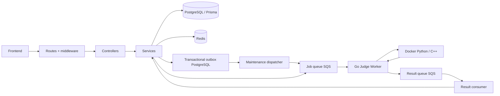

# Backend Online Judge

Backend TypeScript/Express 5 quản lý tài khoản, bài tập, lộ trình, chạy mã và lịch sử nộp bài. Mã backend dùng **ES Modules** (`type: module`, TypeScript `NodeNext`). PostgreSQL lưu dữ liệu chính qua Prisma; Redis lưu run tạm; AWS SQS nối backend với Judge Worker Go/Docker ở `../sandbox/worker`.

## 1. Kiến trúc và trách nhiệm

Backend tổ chức theo tầng. Routes khai báo HTTP; middleware xử lý xác thực, quyền và validation; controller chuyển request sang input service; service thực hiện nghiệp vụ/transaction; config cung cấp kết nối dùng chung. Worker chỉ nhận/xác nhận message và gọi service xử lý kết quả. Service không nhận `req`/`res` của Express.



PostgreSQL đã là tiến trình độc lập trong Docker; `prisma/` và `config/db.ts` ở backend là mã mô tả/kết nối dữ liệu, không phải nơi lưu bản ghi. Chưa cần thêm database HTTP service hoặc repository chỉ bọc từng lệnh Prisma. API và result consumer có thể chạy cùng tiến trình hoặc tách tiến trình mà dùng chung service/schema.

## 2. Cấu trúc tổng quát

```text
backend/
├── .env.example              Mẫu cấu hình, không có secret thật
├── prisma/                   Schema và SQL migrations
├── prisma.config.ts          Cấu hình Prisma CLI
├── src/
│   ├── app.ts                Factory HTTP application
│   ├── server.ts             Entry point API + vòng đời tiến trình
│   ├── config/               Environment và client hạ tầng
│   ├── routes/               Auth/admin/student + router chức năng
│   ├── middlewares/          Auth, validation, lỗi, log
│   ├── controllers/          Lớp HTTP mỏng
│   ├── services/
│   │   ├── auth/             Account, Google, password, profile
│   │   ├── execution/        Run, owner/TTL, polling, result Redis
│   │   └── submission/       Submit, history, detail, result, progress
│   ├── workers/              SQS transport + entry point riêng
│   ├── validation/           Schema request
│   ├── types/                DTO job/result
│   ├── errors/               Lỗi nghiệp vụ có mã
│   └── utils/                Tiện ích không phụ thuộc HTTP
├── tests/                    Hồi quy và integration có kiểm soát
├── package.json / lock       Dependency và scripts
├── tsconfig.json             TypeScript ESM/build
└── README.md                 Tài liệu tổng quan này
```

Các service nghiệp vụ dùng hàm export có tên; auth facade giữ điểm import ổn định. Tách admin/student phản ánh quyền và dữ liệu khác nhau, không phải service dư thừa. Không gộp chạy thử, nộp chính thức, nhận kết quả và tiến độ vào một file lớn.

## 3. Vai trò từng file mã nguồn

Các đường dẫn trong bảng tương đối với `backend/`.

### Khởi động và hạ tầng

| File | Ý nghĩa |
| --- | --- |
| `src/app.ts` | Factory createApp: cấu hình Express, middleware và router; import file này không tự listen hay nhận SQS. |
| `src/server.ts` | Entry point HTTP: mở cổng, tùy chọn chạy result worker cùng tiến trình và graceful shutdown khi SIGINT/SIGTERM. |
| `src/config/env.ts` | Nạp .env, kiểm tra cấu hình bằng Zod và cung cấp env dùng chung; lỗi chỉ in tên trường. |
| `src/config/db.ts` | PostgreSQL pool, adapter PrismaPg và Prisma Client dùng chung; không chứa bản ghi thực tế. |
| `src/config/redis.ts` | Redis client dùng chung, cấu hình retry và log trạng thái kết nối. |
| `src/config/sqs.ts` | AWS SQS client: region, credentials/session token hoặc default credential chain. |
| `src/config/shutdown.ts` | Đóng Prisma, PostgreSQL pool, Redis và SQS khi tiến trình dừng. |

### Routes

| File | Ý nghĩa |
| --- | --- |
| `src/routes/index.ts` | Ghép /auth, /admin và API student/public dưới /api. |
| `src/routes/auth.routes.ts` | Đăng ký, đăng nhập, Google, mật khẩu và profile hiện tại. |
| `src/routes/admin.routes.ts` | Áp authenticate + authorize(ADMIN) cho toàn bộ router quản trị rồi mount router con. |
| `src/routes/student.routes.ts` | Ghép API công khai và riêng tư; category/leaderboard công khai, quyền từng nhóm được khai báo rõ. |
| `src/routes/admin/dashboard.routes.ts` | Thống kê, submission feed, worker monitoring, alerts và analytics. |
| `src/routes/admin/user.routes.ts` | CRUD tài khoản qua quyền ADMIN. |
| `src/routes/admin/problem.routes.ts` | CRUD bài tập và testcase quản trị. |
| `src/routes/admin/roadmap.routes.ts` | CRUD lộ trình quản trị. |
| `src/routes/admin/category.routes.ts` | CRUD danh mục quản trị. |
| `src/routes/student/problem.routes.ts` | Danh sách bài yêu cầu đăng nhập để tính isSolved; chi tiết slug công khai. |
| `src/routes/student/roadmap.routes.ts` | Danh sách lộ trình công khai; chi tiết tiến độ yêu cầu đăng nhập. |
| `src/routes/student/submission.routes.ts` | Chạy thử, polling, nộp chính thức và lịch sử; toàn nhóm yêu cầu đăng nhập. |
| `src/routes/student/ai.routes.ts` | Endpoint giải thích lỗi, yêu cầu đăng nhập. |
| `src/routes/student/profile.routes.ts` | Alias profile/mật khẩu đang được frontend dùng, cùng controller với auth. |

### Middleware, validation và lỗi

| File | Ý nghĩa |
| --- | --- |
| `src/middlewares/rate-limit.middleware.ts` | Redis Lua counter + TTL theo IP/email/user, Retry-After và fail closed khi Redis lỗi. |
| `src/middlewares/auth.middleware.ts` | Đọc JWT từ cookie `HttpOnly` `judge_session`, kiểm tra HS256/userId/role/exp; không nhận Bearer token. |
| `src/middlewares/validation.middleware.ts` | Kiểm tra body/query/params; chuẩn hóa body hợp lệ, không ghi đè getter query Express 5. |
| `src/middlewares/error.middleware.ts` | Response lỗi chung: AppError, lỗi Prisma thường gặp, JSON/encoding/payload, 404 và lỗi ngoài dự kiến. |
| `src/middlewares/request-logger.middleware.ts` | Log method/path/status/duration, bỏ header/body/query chứa credential. |
| `src/validation/request.schemas.ts` | Schema đầu vào và giới hạn cho auth, CRUD, chạy mã, UUID, phân trang và alias. |
| `src/errors/app-error.ts` | Lỗi nghiệp vụ có HTTP status, mã và chi tiết an toàn. |

### Controllers

| File | Ý nghĩa |
| --- | --- |
| `src/controllers/controller.utils.ts` | Kiểu ControllerRequest, currentUserId và sendSuccess; chỉ hỗ trợ lớp HTTP. |
| `src/controllers/common/session.controller.ts` | Logout phiên hiện tại hoặc tất cả phiên; gọi session service. |
| `src/controllers/admin/testcase.controller.ts` | Đọc các phiên bản testcase để admin kiểm tra lịch sử. |
| `src/controllers/common/auth.controller.ts` | Chuyển request tài khoản/profile/mật khẩu sang auth service. |
| `src/controllers/common/category.controller.ts` | Chuyển request danh mục sang category service. |
| `src/controllers/admin/dashboard.controller.ts` | Trả dữ liệu dashboard từ service. |
| `src/controllers/admin/user.controller.ts` | Chuyển request quản trị tài khoản sang service. |
| `src/controllers/admin/problem.controller.ts` | Chuyển request quản trị bài tập sang service. |
| `src/controllers/admin/roadmap.controller.ts` | Chuyển request quản trị lộ trình sang service. |
| `src/controllers/student/problem.controller.ts` | Chuyển bộ lọc/phân trang và danh tính sang problem student service. |
| `src/controllers/student/roadmap.controller.ts` | Trả danh sách và tiến độ roadmap theo người dùng. |
| `src/controllers/student/leaderboard.controller.ts` | Trả bảng xếp hạng với limit đã validation. |
| `src/controllers/student/ai.controller.ts` | Gọi service giải thích lỗi. |
| `src/controllers/student/execution.controller.ts` | Chạy tự do/testcase public và đọc trạng thái; chuyển userId cho quyền sở hữu run. |
| `src/controllers/student/submission.controller.ts` | Nộp chính thức, lịch sử và chi tiết bài nộp của người dùng. |

### Services tài khoản và nội dung

| File | Ý nghĩa |
| --- | --- |
| `src/services/auth.service.ts` | Facade re-export các hàm auth; giữ một điểm import ổn định cho controller. |
| `src/services/auth/account.service.ts` | Đăng ký/đăng nhập mật khẩu, hash, trả user an toàn và phát hành phiên/JWT. |
| `src/services/auth/google.service.ts` | Xác minh Google ID token và tìm/tạo tài khoản OAuth. |
| `src/services/auth/password.service.ts` | OTP 6 số bằng crypto.randomInt, lưu HMAC gắn email; tiêu thụ một lần và thu hồi mọi phiên khi reset/đổi mật khẩu. |
| `src/services/auth/session.service.ts` | Tạo/đọc/thu hồi phiên PostgreSQL; tokenVersion thu hồi toàn bộ phiên và role lấy từ DB mỗi request. |
| `src/services/auth/profile.service.ts` | Đọc tài khoản hiện tại và cập nhật tên hiển thị. |
| `src/services/user.admin.service.ts` | Quản trị tài khoản với mật khẩu riêng bắt buộc, thu hồi phiên khi đổi mật khẩu và soft delete user. |
| `src/services/problem.admin.service.ts` | Quản trị bài, phiên bản testcase bất biến, soft delete và transaction khóa problem khi sửa. |
| `src/services/problem.student.service.ts` | Hàm export đọc bài active, lọc/phân trang, isSolved và chỉ lấy testcase công khai. |
| `src/services/roadmap.admin.service.ts` | CRUD roadmap và thứ tự bài, transaction khi thay danh sách bài. |
| `src/services/roadmap.student.service.ts` | Tính tiến độ và trạng thái bài; mở khóa khi tất cả bài trước đã giải. |
| `src/services/category.service.ts` | CRUD danh mục và kiểm tra tên trùng. |
| `src/services/leaderboard.service.ts` | SQL aggregate COUNT DISTINCT problem đã AC, phân trang trên DB; giữ accepted submissions riêng để tính accuracy. |
| `src/services/dashboard.service.ts` | Thống kê/feed/analytics từ PostgreSQL, trạng thái worker từ heartbeat và cảnh báo SQS/DLQ/outbox thực. |
| `src/services/ai.service.ts` | Gọi AI provider tương thích Chat Completions, timeout/giới hạn response, không trả gợi ý giả khi thiếu cấu hình. |

### Services chạy mã và xử lý kết quả

| File | Ý nghĩa |
| --- | --- |
| `src/services/outbox.service.ts` | Lease bằng FOR UPDATE SKIP LOCKED, gửi lại có backoff, kết thúc job quá hạn và dọn phiên hết hạn. |
| `src/services/queue-admin.service.ts` | Tạo/check queue và DLQ theo flag; đọc queue depth, redrive policy và DLQ để giám sát. |
| `src/services/worker-monitor.service.ts` | Validate/ghi heartbeat Redis theo timestamp, bỏ message cũ, phát hiện worker offline. |
| `src/services/judge-queue.service.ts` | Kiểm tra job queue và gửi payload SQS, dùng chung cho run/submit. |
| `src/services/execution/run.service.ts` | Chọn resource limits và testcase public, tạo run trước gửi job; ghi lỗi nếu không hoàn tất dispatch. |
| `src/services/execution/run-store.service.ts` | Khởi tạo owner/result bằng Redis transaction + TTL; đọc theo owner và ghi lỗi run an toàn. |
| `src/services/execution/status.service.ts` | Định dạng kết quả polling Redis, giữ stdout/stderr và thống kê testcase. |
| `src/services/execution/result.service.ts` | Lua cập nhật kết quả chạy thử nguyên tử, chống đếm trùng, giữ TTL và bỏ kết quả đến sau lỗi dispatch. |
| `src/services/submission/submit.service.ts` | Khóa đọc problem; ghi submission, snapshot kết quả PENDING và outbox jobs trong cùng transaction. |
| `src/services/submission/history.service.ts` | Lịch sử theo userId, phân trang và số testcase hoàn thành/đạt/thất bại. |
| `src/services/submission/detail.service.ts` | Chi tiết theo userId, sắp xếp kết quả và áp chính sách ẩn/public testcase. |
| `src/services/submission/result.service.ts` | Transaction/row lock cập nhật từng testcase, tổng hợp status/time và chống message trùng/đến muộn. |
| `src/services/submission/progress.service.ts` | Ghi một lượt nộp đã chấm xong; cập nhật solved khi ACCEPTED và không xóa tiến độ đã giải khi nộp sai. |
| `src/services/result.service.ts` | Kiểm tra message, điều phối run/official result và trả ack/retry cho worker transport. |

### Worker, kiểu dữ liệu và tiện ích

| File | Ý nghĩa |
| --- | --- |
| `src/workers/maintenance.worker.ts` | Vòng dispatch outbox/reconciliation/session cleanup, hỗ trợ AbortSignal. |
| `src/workers/queue.setup.entry.ts` | CLI ensure queue/DLQ; không tự khởi động API. |
| `src/workers/queue.ready.entry.ts` | Retry kiểm tra queue tối đa 30 lần; chỉ tạo/cấu hình queue khi lệnh triển khai đặt SQS_AUTO_CREATE=true. |
| `src/workers/result.worker.ts` | Vòng long-poll SQS; gọi result service, chỉ delete khi được ack và hỗ trợ AbortSignal. |
| `src/workers/result.worker.entry.ts` | Entry point chạy result consumer và maintenance/outbox riêng; nhận signal và đóng infrastructure. |
| `src/types/execution.ts` | DTO input chạy/nộp mã và hợp đồng job gửi Go Worker. |
| `src/types/judge-result.ts` | Schema Zod/type payload nhận Go Worker và kiểu disposition ack/retry. |
| `src/utils/auth.ts` | bcryptjs hash/compare, JWT ký HS256 và verify; JWT_SECRET bắt buộc từ cấu hình. |
| `src/utils/emailService.ts` | SMTP transport và email OTP; lỗi provider được xử lý trong password service để không tiết lộ tình trạng tài khoản. |
| `src/utils/slugify.ts` | Chuẩn hóa tiêu đề thành thành phần slug. |
| `src/utils/submission-status.ts` | Chuẩn hóa AC/WA/TLE/MLE/RE/CE, thứ tự ưu tiên trạng thái và giới hạn số milliseconds cho PostgreSQL Int. |

## 4. Các file ngoài src

| File/thư mục | Ý nghĩa |
| --- | --- |
| `package.json` | Thư viện trực tiếp và lệnh chạy/build/test/Prisma. Dependency không dùng đã được dọn; backend không dựa vào bcrypt ở root. |
| `package-lock.json` | Khóa dependency cho `npm ci`; cập nhật cùng package.json khi thêm/bỏ thư viện. |
| `tsconfig.json` | NodeNext + strict, import nội bộ đuôi `.js`, rootDir `.`, outDir `dist`, giữ cú pháp ESM và import type. |
| `.env` | Cấu hình thật của máy chạy, Git ignore; không ghi password/token vào tài liệu hoặc commit. |
| `.env.example` | Danh sách cấu hình mẫu và giá trị mặc định. |
| `.gitignore` | Bỏ .env, node_modules và dist khỏi Git. |
| `prisma.config.ts` | Prisma CLI đọc schema/DATABASE_URL; không khởi động API/worker. |
| `docker-entrypoint.sh` | Khi chạy API trong Docker: kiểm tra migration/queue rồi exec server; không tự áp schema hay tạo queue. Các CMD triển khai riêng bỏ qua bước kiểm tra API. |
| `prisma/schema.prisma` | Model/enum/quan hệ, không chứa dữ liệu thật. |
| `prisma/migrations/*/migration.sql` | Lịch sử DDL để tái tạo/cập nhật cấu trúc database. |
| `prisma/migrations/migration_lock.toml` | Provider của lịch sử migration. |
| `dist/` | JavaScript ESM sau build, không chỉnh sửa trực tiếp. |
| `node_modules/` | Dependency và Prisma Client sinh tự động. |
| `tests/routes.contract.json` | Hợp đồng 51 endpoint/method/controller/quyền (48 cũ + 3 mới) để kiểm tra tương thích. |
| `tests/routes.test.mjs` | 153 lượt kiểm tra quyền/điều hướng cho 51 endpoint, token sai và 404. |
| `tests/middleware.test.mjs` | JWT, schema, alias, lỗi JSON/encoding/413, quyền và log an toàn. |
| `tests/auth-fixture.mjs` | Session delegate giả lập riêng cho test routing/controller; không thay đổi xác thực production. |
| `tests/hardening.test.mjs` | AI provider HTTP fixture, rate limit và DB session/role/version checks. |
| `tests/health.test.mjs` | Health API trả 200 khi database/cache sẵn sàng và 503 an toàn khi một kết nối lỗi. |
| `tests/controllers.test.mjs` | Controller/service thật qua HTTP với Prisma/Redis/SQS giả lập. |
| `tests/services.test.mjs` | Testcase versioning, result/progress/idempotency, owner, roadmap, OTP, worker và env. |
| `tests/redis.integration.test.mjs` | Opt-in Redis thật: Lua đồng thời, trùng message, owner, TTL và lỗi dispatch; chỉ dùng key UUID tạm. |
| `tests/migrations.integration.test.mjs` | Opt-in PostgreSQL container tạm: chạy toàn bộ SQL, so cột model và chạy lại migration mới; không dùng volume dự án. |
| `ROUTES.md` | Danh sách URL, method, quyền và quy tắc router. |
| `MIDDLEWARE.md` | Validation, xác thực/phân quyền, lỗi và giới hạn request. |
| `CONTROLLERS.md` | Quy tắc controller mỏng và cách thêm endpoint. |

## 5. Luồng hoạt động

### Khởi động và dừng

`npm run dev` chạy `src/server.ts`; `npm start` chạy `dist/src/server.js`. Entry point đọc env, tạo HTTP app và mở cổng (mặc định 5001). `createApp()` áp CORS/header → request logger → JSON parser 1 MiB → `/api` router → notFound → errorHandler.

Mặc định `RESULT_WORKER_ENABLED=true` giữ cách chạy API + result consumer + maintenance cùng tiến trình. Khi tách worker, đặt flag này thành false cho API và chạy entry point worker riêng. Không cần frontend đổi URL.

SIGINT/SIGTERM dừng nhận HTTP mới, hủy long-poll SQS, chờ xử lý đang chạy và đóng client/pool. HTTP server có hạn chờ shutdown 15 giây. Import `app.ts` không tự mở cổng hay poll queue.

### Đăng ký, đăng nhập và mật khẩu

1. Rate limit theo IP; validation chuẩn hóa email; login/OTP còn có budget riêng theo email.
2. Account service hash/so sánh mật khẩu bcryptjs. Google service xác minh ID token/email_verified; cả Google Sign-In cũng yêu cầu client gửi chấp thuận điều khoản trước khi tạo phiên/tài khoản.
3. Đăng ký bắt buộc xác nhận điều khoản; backend lưu `termsAcceptedAt` và `termsVersion` (`TERMS_VERSION`). Đăng nhập/Google tạo AuthSession rồi ký JWT HS256; response đặt JWT vào cookie `HttpOnly`, không trả token cho JavaScript.
4. Mỗi request kiểm tra JWT, sau đó đọc session và user từ DB. Session bị revoke/hết hạn, user soft-deleted hoặc version khác đều bị từ chối. Quyền luôn lấy role hiện tại trong DB.
5. `/auth/logout` revoke jti hiện tại và xóa cookie; `/auth/logout-all` tăng tokenVersion và xóa cookie hiện tại. Đổi/reset mật khẩu cũng tăng version, thu hồi phiên và xóa cookie.
6. OTP 6 chữ số, hạn 15 phút; DB chỉ lưu HMAC-SHA256 gắn email và secret. Conditional update tiêu thụ đúng một lần; plaintext OTP chỉ đi qua SMTP.
7. Admin tạo tài khoản phải cấp mật khẩu riêng; không còn password chung mặc định. Frontend gửi cookie phiên qua Axios/fetch, không giữ JWT trong Web Storage. Khi admin xóa mềm user, email được thay bằng địa chỉ `.invalid` để nhường email cũ cho đăng ký mới; lịch sử vẫn gắn với user ID cũ.

### Đọc/quản lý bài tập và lộ trình

Admin router bảo vệ toàn nhóm bằng ADMIN. Service kiểm tra tài nguyên/danh mục, xử lý nested writes và transaction. Student chỉ nhận bài active/testcase public, trạng thái đã giải và tiến độ cá nhân. Roadmap mở bài khi tất cả bài trước đã giải; học viên giải bài độc lập vẫn có thể có trạng thái COMPLETED cho bài đó.

Cập nhật bài giữ ID testcase nếu dữ liệu không đổi. Khi thay đổi, transaction khóa problem, retire testcase cũ bằng deletedAt, tăng testcaseVersion và tạo ID mới. Submission cũ vẫn tham chiếu nội dung testcase bất biến; submission mới chỉ dùng version hiện hành. Admin xem `/admin/problems/:id/testcases/versions`.

DELETE user/problem/category/roadmap qua API chuyển sang soft delete; tài nguyên bị ẩn khỏi danh sách mới. Những foreign key bảo vệ submission/result/progress chuyển sang RESTRICT để physical DELETE không xóa dây chuyền lịch sử. Không có API purge dữ liệu lịch sử.

### Chạy thử: PLAYGROUND / PROBLEM_TRIAL

1. Route xác thực, validation ngôn ngữ/source/input/problemId.
2. Execution service sinh `run-<UUID>`, lưu `run_owner:<runId>` và `run_result:<runId>` trong một Redis transaction với TTL mặc định 3600 giây.
3. PLAYGROUND gửi input tùy ý; khi có problemId dùng giới hạn bài tập. PROBLEM_TRIAL chỉ lấy testcase public, mỗi testcase là một job; không có testcase public thì gửi một job PLAYGROUND.
4. Go Worker chạy Docker và publish kết quả SQS. Backend consumer dùng Lua thêm kết quả nguyên tử, bỏ testcase trùng và tính completed/passed/failed.
5. Polling kiểm tra owner trước khi đọc output. Run của người khác/đã hết hạn trả 404 RUN_NOT_FOUND. Không tạo Submission chính thức trong PostgreSQL.
6. Dispatch không hoàn tất ghi SYSTEM_ERROR cho run; kết quả đến muộn không ghi đè lỗi này. Run tạm được tạo trước refactor không có owner metadata sẽ không còn đọc được; hãy chạy lại.

TTL tính từ lúc khởi tạo, kết quả không sống lâu hơn owner. Run PENDING/RUNNING vẫn có hạn, tránh key tồn tại vô hạn. Trạng thái trial kết thúc là ACCEPTED khi tất cả public testcase đạt hoặc COMPLETED khi có testcase lỗi; từng testcase giữ trạng thái chi tiết.

### Nộp chính thức: PROBLEM_SUBMIT

1. Khóa problem bằng FOR SHARE để thống nhất với cập nhật version testcase.
2. Transaction ghi Submission, testcaseVersion, deadlineAt, SubmissionResult PENDING/expected snapshot và toàn bộ OutboxJob. HTTP trả 201 sau commit; SQS lỗi tạm thời không làm mất bài đã nhận.
3. Maintenance worker claim tối đa 10 job bằng FOR UPDATE SKIP LOCKED, lease token 120 giây; gửi SQS ngoài transaction và chỉ đánh dấu sentAt khi được xác nhận. Retry exponential backoff, tối đa 60 giây/lần. Sau 10 lần gửi lỗi kết thúc SYSTEM_ERROR.
4. Crash giữa send và sentAt có thể gây gửi trùng; result consumer có row lock và dedup theo testcase để không tăng kết quả/progress hai lần.
5. Deadline mặc định tối thiểu 1800 giây; service tăng deadline theo số testcase và giới hạn chạy/biên dịch. Reconciliation kết thúc bài PENDING/IN_PROGRESS quá deadline bằng SYSTEM_ERROR, đóng các kết quả còn chờ và hủy outbox chưa gửi. Kết quả đến muộn bị bỏ qua.
6. Go Worker tách compilation C++ khỏi execution cgroup. Run bị giới hạn bằng timeout process group; OOM xác nhận bằng memory.events. memoryUsed là peak cgroup KiB, cpuTime là cgroup CPU ms, executionTime là wall ms của bước exec (không gồm compile/container setup), compileTime tách riêng.
7. Result service cập nhật từng testcase và tổng hợp theo SYSTEM_ERROR → CE → RE → MLE → TLE → WA → ACCEPTED. maxMemory lấy peak lớn nhất đã đo; giá trị chưa đo là null. CE không chạy chương trình nên thời gian execution ghi 0 ở kết quả chính thức, không phải thời gian biên dịch.
8. Progress ghi một attempt khi kết thúc, kể cả lỗi hạ tầng đã nhận vào outbox; AC cập nhật solved, lượt sai sau đó không xóa solved. Lịch sử/chi tiết luôn lọc userId và giữ version testcase cũ.

### Nhận kết quả, heartbeat và DLQ

Result worker long-poll tối đa 10 message/lần, chờ 20 giây. Nó nhận cả judge result và WORKER_HEARTBEAT; heartbeat được validate và ghi Redis theo timestamp, không ghi vào bảng submission. Worker quá WORKER_OFFLINE_SECONDS không có heartbeat được báo OFFLINE.

JSON/protocol sai và lỗi lưu trữ giữ message để retry/DLQ; dữ liệu hợp lệ đã lưu, message trùng và run hết TTL được ack/delete. Không log raw code, stdin, expected output hoặc program output trong worker.

Lệnh triển khai `sh docker/deploy.sh` tạo/check queue và DLQ bằng SQS_AUTO_CREATE=true; backend khi khởi động chỉ kiểm tra queue với SQS_AUTO_CREATE=false. RedrivePolicy có maxReceiveCount=3. `queues:ensure` vẫn dùng được khi chạy native. IAM cho AWS phải cấp quyền phù hợp. Tham khảo [AWS CreateQueue/RedrivePolicy](https://docs.aws.amazon.com/AWSSimpleQueueService/latest/APIReference/API_CreateQueue.html).

## 6. Database và nơi lưu dữ liệu

| Model | Dữ liệu |
| --- | --- |
| User / AuthSession | Tài khoản, role, hash mật khẩu/HMAC OTP, thời điểm/phiên bản điều khoản, tokenVersion, soft delete; session jti/revokedAt/expiresAt. |
| Category / ProblemCategory | Danh mục và liên kết nhiều-nhiều với bài tập. |
| Problem | Đề bài, slug, difficulty, resource limits, checkerType, isActive. |
| Testcase | Input/expectedOutput bất biến theo version, public/hidden, thứ tự và thời điểm retire. |
| Submission / OutboxJob | Source, user/problem, testcaseVersion/deadline; payload bền vững, attempts/lease/sentAt/cancelledAt. |
| SubmissionResult | Kết quả, output/error, wall time, peak memory KiB, CPU ms, compile ms. |
| AILog | Mô hình lưu phản hồi AI; chức năng AI hiện chưa ghi log thực. |
| Roadmap / RoadmapProblem | Lộ trình và thứ tự bài. |
| RoadmapProgress | Tiến độ user theo roadmap/problem và submission AC gần nhất. |

Với `../docker-compose.yml`, PostgreSQL ở container `judge_postgres`, host port **5433**, database `judge_db`, dữ liệu trong volume **judge-system-monorepo_postgres_data**. `/var/lib/postgresql/data` là mount bên trong container. Schema/migrations trong repo không phải bản sao lưu dữ liệu.

Migration thứ tư `20261013000000_add_roadmap_progress` ghi lại model còn thiếu trong lịch sử DDL. Nó dùng CREATE TABLE/INDEX IF NOT EXISTS để không drop/recreate bảng local đã có. **Migration đã được kiểm tra trong PostgreSQL tạm và có trong lịch sử migration của database dự án.** Với database đã có schema tùy chỉnh, IF NOT EXISTS không sửa mọi khác biệt cột/constraint: phải đối chiếu trước khi áp dụng; không chọn reset chỉ để bỏ cảnh báo drift.

Migration `20261014000000_backend_reliability` thêm session, outbox, soft-delete/version/metrics/indexes và FK RESTRICT. Các giá trị memoryUsed=0 từ worker cũ chuyển thành null để thể hiện chưa đo. Migration đã được kiểm tra trên database tạm và áp thành công vào database dự án ngày 14/10/2026, sau khi tạo backup. Đối chiếu trước/sau giữ nguyên số bản ghi: 1 user, 17 problems, 27 submissions và 32 submission_results. JWT/OTP cũ không có session/HMAC hợp lệ cần đăng nhập hoặc yêu cầu mã mới.

## 7. Cấu hình môi trường

Dùng `.env.example` làm mẫu nếu chưa có `.env`; giữ file cấu hình đang hoạt động. DATABASE_URL phải khớp user/password/port PostgreSQL hiện tại. Env được nạp từ thư mục làm việc nên chạy lệnh trong `backend/`.

| Biến | Ý nghĩa / mặc định |
| --- | --- |
| DATABASE_URL | Bắt buộc; PostgreSQL URL, local Docker dùng localhost:5433/judge_db. |
| JWT_SECRET | Bắt buộc, không còn secret fallback; dùng giá trị ngẫu nhiên mạnh. |
| PORT | Cổng HTTP, mặc định 5001. |
| REDIS_URL | Mặc định redis://localhost:6379. |
| RUN_TTL_SECONDS | 3600; cho phép 60–86400 giây. |
| RESULT_WORKER_ENABLED | true/false hoặc 1/0; mặc định true cho consumer gộp cùng API. |
| SQS_QUEUE_URL | Job queue; thiếu thì run/submit trả 503 QUEUE_UNAVAILABLE. |
| RESULT_QUEUE_URL | Result queue; bắt buộc khi chạy entry worker riêng. |
| SQS_ENDPOINT_URL | Để trống dùng AWS; Docker local dùng http://sqs:9324 (ElasticMQ). |
| CORS_ORIGINS / TRUST_PROXY_HOPS | Danh sách origin HTTP(S) cụ thể; mặc định localhost:5173/8080. Trust proxy local=0, Compose qua Nginx=1. |
| RATE_LIMIT_ENABLED | true mặc định; không cho tắt khi NODE_ENV=production. |
| SESSION_TTL_SECONDS | 604800; tối đa 7 ngày. |
| SUBMISSION_TIMEOUT_SECONDS / MAINTENANCE_INTERVAL_SECONDS | 1800 / 5; deadline tối thiểu và chu kỳ dispatch/reconciliation. |
| WORKER_OFFLINE_SECONDS | 45; heartbeat Go mỗi 10 giây. |
| SQS_AUTO_CREATE | false mặc định chạy Node local, true mặc định Compose; tạo queue/DLQ nếu bật. |
| AI_API_URL / AI_MODEL / AI_API_KEY / AI_TIMEOUT_MS | Full Chat Completions endpoint, model và key tùy provider; timeout 20000 ms. Thiếu URL/model trả 503. |
| AWS_REGION | Mặc định ap-southeast-1. |
| AWS_ACCESS_KEY_ID / AWS_SECRET_ACCESS_KEY | Phải cấu hình đủ cặp hoặc để trống dùng default AWS credential chain/IAM role. |
| AWS_SESSION_TOKEN | Tùy chọn cho credentials tạm thời. |
| GOOGLE_CLIENT_ID | Cho Google Login; thiếu trả 503 GOOGLE_UNAVAILABLE. |
| TERMS_VERSION | Phiên bản điều khoản ghi nhận khi đăng ký; mặc định `v1`, cần tăng khi nội dung điều khoản được cập nhật. |
| SMTP_HOST / SMTP_PORT | Mặc định smtp.gmail.com / 587; port 465 dùng TLS trực tiếp. |
| SMTP_USER / SMTP_PASS | Cần để gửi OTP. Nếu thiếu hoặc nhà cung cấp lỗi, API quên mật khẩu vẫn trả phản hồi chung để tránh tiết lộ email có tài khoản hay không; OTP sẽ không được gửi. |

Input validation: JSON 1 MiB, source/input mỗi trường 64 KiB UTF-8, page tối đa 1000000, limit tối đa 100, timeLimit bài 1–60000 ms, memoryLimit 1–1024 MiB. Password mới tối thiểu 6 ký tự và tối đa 72 byte UTF-8. Xem [MIDDLEWARE.md](MIDDLEWARE.md) cho đầy đủ.

## 8. Cài đặt và chạy

Yêu cầu Node.js `^20.19`, `^22.12` hoặc `>=24.0` theo engines của Prisma (đã kiểm tra trên Node 24), npm, PostgreSQL và Redis. Luồng chấm cần hai SQS queue (AWS hoặc ElasticMQ local), credentials tương ứng, Go Worker đang chạy và hai Docker image `python-sandbox`, `cpp-sandbox`. `docker-compose.yml` root đóng gói toàn bộ frontend, API, result consumer, Go Worker, PostgreSQL, Redis và SQS local. Hướng dẫn đầy đủ ở [DOCKER.md](../DOCKER.md).

Từ root, tạo cấu hình và khởi động PostgreSQL nếu cần:

```sh
node docker/setup-env.mjs
docker compose up -d postgres
```

Trong backend:

```sh
cd backend
npm ci
npm run db:generate
npm run db:validate
npm run typecheck
npm run dev
```

Schema generation/validation không tạo dữ liệu hay áp migration. Database mới cần áp lịch sử migration bằng Prisma theo quy trình của bạn; database đang có dữ liệu cần đối chiếu và sao lưu trước thay đổi cấu trúc. Không chạy migrate reset để sửa lỗi kết nối.

Build và chạy ESM:

```sh
npm run build
npm start
```

Nếu cần tách API và result consumer khi chạy native để debug, dùng hai terminal ở backend (Compose mặc định đã gộp cả hai):

```sh
# Terminal API
RESULT_WORKER_ENABLED=false npm run dev

# Terminal result consumer
npm run worker:dev
```

Bản build tương ứng dùng `RESULT_WORKER_ENABLED=false npm start` và `npm run worker:start`. Go Judge Worker vẫn là tiến trình khác trong `sandbox/worker`; result consumer Node không thay thế worker thực thi Python/C++.

## 9. Scripts và kiểm tra

| Lệnh | Công dụng |
| --- | --- |
| npm run dev / npm start | API development / bản ESM đã build. |
| npm run queues:ensure | Build và tạo/check job/result queues + DLQ theo SQS_AUTO_CREATE. |
| npm run worker:dev / npm run worker:start | Result consumer độc lập ở development / bản build. |
| npm run build / npm run typecheck | Sinh dist / kiểm tra TypeScript không emit. |
| npm run db:generate / npm run db:validate | Sinh Prisma Client / kiểm tra schema. |
| npm run db:deploy | Prisma migrate deploy; chạy rõ ràng trong docker/deploy.sh hoặc bằng lệnh triển khai riêng. |
| npm run db:status | Prisma migrate status; kiểm tra migration, không áp thay đổi schema. |
| npm run db:migrate | Prisma migrate dev, có thể thay đổi schema và hỏi reset khi drift; không chạy tự động khi boot. |
| npm test | Build + tất cả unit/hồi quy HTTP; integration thật mặc định skip. |
| npm run test:routes / test:middleware / test:controllers | Kiểm tra riêng từng tầng. |
| npm run test:services | Kiểm tra nghiệp vụ/service/result worker với client giả lập. |
| npm run test:redis | Redis thật với key tạm và cleanup, yêu cầu Redis đang hoạt động. |
| npm run test:migrations | Docker PostgreSQL tạm dùng tmpfs, không publish cổng/không mount volume dự án; yêu cầu image postgres:15-alpine có sẵn. |

Unit/HTTP tests kiểm tra routing, controller/service, OTP/session/rate limit và AI provider boundary; các integration Redis/PostgreSQL opt-in được chạy riêng. `sh docker/test.sh` kiểm tra luồng thực bằng PostgreSQL/Redis/ElasticMQ/Go/Docker và xác nhận backup/restore với dữ liệu fixture, trên volume tạm độc lập.

## 10. Các phần đã triển khai và điều kiện vận hành

| Mục trước đây còn thiếu | Triển khai hiện tại |
| --- | --- |
| AI và dashboard demo | AI gọi provider cấu hình thật; dashboard lấy PostgreSQL, heartbeat và SQS/DLQ, không còn số liệu giả. |
| Rate limit / OTP plaintext | Redis atomic limit theo IP/email/user; OTP 6 số lưu HMAC, 15 phút, single-use. |
| JWT không thu hồi / password chung | AuthSession + tokenVersion, logout/logout-all, role hiện tại từ DB, reset/đổi mật khẩu thu hồi phiên; admin phải cấp password riêng. |
| Outbox / DLQ / worker heartbeat / bài chờ vô hạn | Transactional outbox + lease/backoff, queue/DLQ bootstrap, heartbeat và deadline reconciliation. |
| Testcase chưa có version / cascade history | Retire/version testcase, soft delete tài nguyên và FK RESTRICT bảo vệ lịch sử. |
| Peak memory / time sai nghĩa | Execution cgroup riêng, peak KiB/CPU ms, wall/compile time tách riêng; null nếu không đo được. |
| Leaderboard đếm lần AC | COUNT DISTINCT problem và LIMIT/OFFSET trên PostgreSQL, index hỗ trợ query. |
| CORS mở | Allowlist origin; trust proxy số hop cấu hình rõ. |
| Evidence chưa đủ cho tích hợp/backup | Docker integration thực cho cả luồng chấm/bảo mật/outbox; pg_dump/pg_restore vào DB độc lập có đối chiếu số bản ghi. |

AI cần AI_API_URL, AI_MODEL và key nếu provider yêu cầu; chưa gửi source tới provider ngoài trong kiểm thử, dùng HTTP provider fixture để kiểm tra hợp đồng/lỗi/timeout. Định dạng API dựa trên [OpenAI Chat Completions](https://developers.openai.com/api/reference/resources/chat/subresources/completions/methods/create). SQS local đã kiểm thử; AWS SQS/SMTP/Google thật cần credentials và kiểm thử trong môi trường triển khai.

Peak memory/CPU là số đo cgroup v2, gồm process/wrapper trong container execution, không phải RSS riêng của một process. Kernel thiếu counters trả null. Tham khảo [Linux cgroup v2](https://www.kernel.org/doc/html/latest/admin-guide/cgroup-v2.html). Không công bố output fixture như bằng chứng đã kiểm thử AWS hoặc provider AI thật; backup và kiểm thử vẫn là hai công việc độc lập.

## 11. Container Docker

Triển khai lần đầu hoặc khi schema/queue đổi: chạy `sh docker/deploy.sh` từ root để kiểm tra AWS, chuẩn bị queue/DLQ, backup và áp migration bằng container lệnh tạm (`run --rm`), rồi khởi động hệ thống. Những lần khởi động thông thường dùng `docker compose up -d`. Compose chính chỉ có 5 container thường trực, không có ElasticMQ hoặc container result-worker riêng.

Backend đặt `RESULT_WORKER_ENABLED=true`, chạy HTTP API, result consumer và maintenance/outbox trong cùng tiến trình, cùng nhận graceful shutdown. Không chạy thêm `npm run worker:start` với cấu hình này. `docker-entrypoint.sh` chỉ kiểm tra migration/queue trước khi mở API; nếu còn migration thiếu thì cần chạy deploy. Go worker tự build image Python/C++ khi thiếu hoặc checksum Dockerfile thay đổi. `/health` kiểm tra PostgreSQL và Redis; frontend gọi `/api` cùng origin qua Nginx và chờ backend/sandbox sẵn sàng.

`backend/Dockerfile` có stage build, production-dependencies và runtime; runtime chứa dependencies production (gồm Prisma CLI), mã ESM, schema/migrations và entrypoint, chạy user `node`. `.dockerignore` loại `.env`, node_modules và output máy host khỏi image. Image không chứa credentials. `docker compose up -d` không tự backup hay áp migration; `docker/deploy.sh` thực hiện hai việc này, `docker/start.sh` là alias của deploy. Xem [DOCKER.md](../DOCKER.md) cho volume, backup, cổng truy cập và AWS SQS. ElasticMQ và cách tắt worker tạm thời chỉ có trong stack integration test độc lập.
